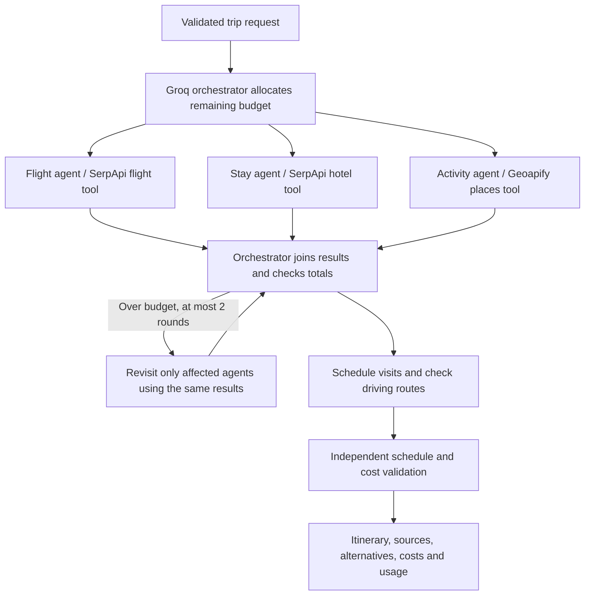

# Roam Team

A working local multi-agent travel planner for India and selected international destinations. A LangGraph orchestrator coordinates independent flight, accommodation and activity specialists, then checks budget arithmetic and schedules visits around flights and driving estimates.

**Live integrations:** Groq, SerpApi Google Flights/Hotels and Geoapify places/routing. One live Delhi → Goa trip and a zero-network cached replay have been verified. This is a planning application, not a booking service.

## Run in VS Code

Open this project folder. In a terminal:

```sh
.venv/bin/python run.py
```

Open [the planner](http://127.0.0.1:8003). Stop any existing server on port 8003 before starting another. The `.venv` environment is already installed on this machine.

For a fresh checkout with Python 3.11+:

```sh
python3 -m venv .venv
.venv/bin/python -m pip install -r requirements.txt
.venv/bin/python -m scripts.accounts bootstrap
.venv/bin/python run.py
```

VS Code settings configure the interpreter, `.env` injection for new terminals and the **Run Roam Team** debugger. The frontend is HTML/CSS/JavaScript served by FastAPI; Node is not needed to run the app.

## Configuration

Your local `.env` holds:

```env
GROQ_API_KEY=...
GROQ_MODEL=openai/gpt-oss-20b
SERPAPI_API_KEY=...
GEOAPIFY_API_KEY=...
SERPAPI_31_DAY_LIMIT=200
SERPAPI_DAILY_LIMIT=10
GEOAPIFY_DAILY_LIMIT=500
GROQ_DAILY_CALL_LIMIT=100
```

Use `.env.example` for new checkouts. Never overwrite an existing `.env` with the example or publish your keys. The `openai/` prefix in the model ID names an open-weight model hosted on **Groq**; no OpenAI API call or key is used. The retired Amadeus adapter has been removed.

After editing credentials, save the file and click Recheck API connection. An available UI mode means the key is present, not that the account has been authenticated; actual requests check access.

| Mode | Decisions | Travel information |
|---|---|---|
| Demo | Deterministic rules in separate graph nodes | Fictional catalog; no external calls |
| Groq team | Separate structured Groq calls | Same fictional catalog |
| Live search | Separate structured Groq calls | Real search results and place records, with explicit cost estimates where necessary |

## Protecting the free quotas

The cache and quota ledger persist in `.local/state.sqlite3`, excluded from source control. Restarting the server does not reset usage. Keep this database to retain local safeguards. Use only one local server worker; quota reservations are atomic, while in-flight deduplication is process-local.

| Service | What one new trip uses | Cache lifetime | Default local cap |
|---|---|---|---|
| SerpApi | At most 3 search attempts: outbound list, return choices for one outbound, first hotel page | 6 hours | 10 / rolling 24h; 200 / rolling 31 days; 40 / rolling hour |
| Geoapify | 1 places request (20 results), plus at most 1 basic driving route per activity day | Places: 7 days; routes: 24h | 500 credits / rolling 24h; calls spaced at least 300ms |
| Groq | Normally 4 calls; targeted revisions only; hard per-trip maximum 12 calls | Decisions: 24h | 100 / rolling 24h; 20 / minute; calls spaced at least 3.1 seconds |

Geoapify requests use basic places/routing only: no isochrones, isodistances, routing matrices, premium route details, elevation or map-tile downloads. Each places query is capped at 20 results and each route has at most four waypoints.

Additional protections:

- Flight/hotel cache keys include route, dates, adults and currency, **not budget or interests**. Changing the budget does not repeat those searches.
- Place results are shared across dates and traveler counts for the same destination; interests are applied after retrieval.
- Identical simultaneous requests share their result within the server process.
- Search pagination, price-refresh loops and automatic provider retries are disabled.
- Failed attempts count conservatively against local limits.
- Cached results still work when a local cap is reached; expired prices are not silently reused.
- Before uncached SerpApi searches, its free Account API checks plan balance. The last 20 plan searches are protected. The balance is cached for 60 seconds; use in other apps can change it meanwhile. Extra paid credits are not intentionally used.
- Limits cannot be raised above conservative hard ceilings in code. A zero cap disables new requests for that service.
- No paid-provider fallback exists. Groq account billing is not controlled by the app; keep your account on its free plan.

The usage panel shows **local conservative reservations**, not an authoritative bill. The SerpApi account check is free and does not consume search credits. Never delete the database simply to bypass a limit. Do not share these keys with other applications if you need predictable quota allocation.

## Agents and coordination



Each specialist has separate instructions, a domain-specific search tool, structured input and a validated selection. The model can select supplied offer IDs, but cannot invent offers or change their prices. Candidate payloads are compact to limit token use. Cached model decisions are keyed by the model, prompt, schema and input; unrelated decisions cannot collide.

The conversation panel streams actual delegation, search, selection and revision events. It displays short decision summaries, not private chain-of-thought. Provider failures are surfaced as missing data; successful branches can still produce a clearly incomplete plan.

## Data and itinerary behavior

- Supported origins: Delhi, Mumbai, Bengaluru, London and New York. Destinations: Goa, Jaipur, Bali, Paris and Tokyo. India and global provider support does not imply every route/date has an available result.
- One destination, 1–4 adults, 1–14 nights, departures within 330 days, INR budgets. The return date is departure from the destination.
- To conserve SerpApi searches, only the cheapest valid outbound is expanded for return choices; the flight agent compares those complete combinations. Hotel search uses only the first result page. This is not exhaustive fare optimization.
- Outbound arrival must be same-day and before 21:00; return departure must be at or after 03:00. Those bounds keep transfer buffers on the correct day. Unsupported options are excluded rather than rescheduled inaccurately.
- Flight costs use the returned round-trip search total. Hotel costs use the entire-stay total when available, otherwise a labeled nightly-rate estimate. Passenger/room configuration, taxes, baggage and final prices must be rechecked with the booking source.
- Geoapify supplies actual place records. Missing entrance fees get a visible planning allowance; they are never treated as free. Only explicitly free source records get a listed-free label.
- Meals, local transport and unknown admission fees are estimates. A 10% contingency is included. Visas, insurance, baggage and origin-airport transfers are not priced.
- Activity visits are two-hour planning blocks. The live route check adds conservative transfer buffers and removes activities that no longer fit; removed activity costs are excluded.
- Driving estimates are not live traffic. Opening hours are displayed if supplied but are not fully date/holiday validated. Hotel check-in/out times are planning assumptions. The application is not a guarantee of admission or bookability.
- Geoapify/OpenStreetMap attribution appears on live plans. Source timestamps show the age of cached quotes. Links lead to provider/search pages for confirmation.
- Plans are request-local; download JSON or print the browser page to retain one. The cache persists search records and usage, not an authenticated user account/history.

## Validation and evaluation

```sh
.venv/bin/python -m pytest -q
.venv/bin/python -m scripts.evaluate --compare
```

Automated tests use isolated databases, test credentials and recorded-shaped responses. They exercise concurrent searches, cached requests, persistent quotas, provider balances, amount normalization, unknown fee handling, independent schedule validation and the API. They do not spend your real provider quotas.

`docs/live-validation.json` records the live smoke test: 3 SerpApi searches, 4 Geoapify requests and 4 Groq calls. The exact replay made **zero external requests** and reused seven travel responses and four AI decisions. `docs/evaluation.json` is the eight-scenario demo evaluation, with a deterministic no-revision ablation—not evidence that a multi-agent AI outperforms a single AI.

A real Groq single-call comparison is available but is not run by default:

```sh
.venv/bin/python -m scripts.evaluate --mode ai --compare --output docs/ai-evaluation.json
```

It uses sample travel data and consumes Groq quota. Run repeated, broader evaluations before making comparative résumé claims. See `docs/VALIDATION.md` for current evidence and remaining limitations.

## Files and API

- `app/agents/`: orchestrator and specialists.
- `app/providers/live.py`: SerpApi and Geoapify normalization; `demo.py`: fictional fixtures.
- `app/services/cache.py`: persistent cache, deduplication and atomic usage reservations.
- `app/llm.py`: Groq calls, validation and decision caching.
- `app/planning.py`: scheduling, route buffers and independent cost/time validation.
- `app/main.py`: same-origin FastAPI backend, stream and usage endpoint.
- `dist/`: web interface; `tests/`: regression checks.

[API documentation](http://127.0.0.1:8003/docs): `POST /api/plan`, `POST /api/plan/stream`, `GET /api/config`, `GET /api/usage`. Response money is integer **paise**; request budgets are whole **rupees**.

This is a localhost application with host/origin checks and three concurrent planning slots. Public deployment needs authentication, durable per-user rate limits, secret management and a hosting configuration; do not expose this development server directly to the internet.

## Provider references

- [Groq structured outputs](https://console.groq.com/docs/structured-outputs)
- [SerpApi flight search](https://serpapi.com/google-flights-api), [hotel search](https://serpapi.com/google-hotels-api), [free Account API](https://serpapi.com/account-api)
- [Geoapify Places](https://apidocs.geoapify.com/docs/places/), [Routing](https://apidocs.geoapify.com/docs/routing/), [pricing](https://www.geoapify.com/pricing/)

### Location search and API connection

Use **http://127.0.0.1:8003** for this version. Older servers may still be running on ports 8000 or 8001. Start with `.venv/bin/python run.py` from this folder; VS Code's launch configuration also uses port 8003.

Both location fields search 3,941 bundled airports, including 113 in India. Type a city, country, airport name or IATA code and choose a suggestion. A three-letter code also works directly. Airports appear in both fields; selecting the same airport twice is rejected. This catalog does not guarantee flights for a particular route or date.

The catalog is a filtered snapshot of [OurAirports public-domain data](https://ourairports.com/data/), downloaded September 13, 2026: scheduled-service airports with IATA codes and municipality names, excluding heliports and seaplane bases. `app/data/airports.json` is included in the application; searching it makes no provider calls. The original five destination profiles retain their city coordinates. Other live destinations use one Geoapify city-geocoding request, cached for 30 days, before place discovery. City lookup failure is reported rather than searching around an airport. Additional destinations use generic, explicitly estimated daily allowances and synthetic demo prices; they are not destination-specific price research.

Save credentials in this project's `.env`, then click **Recheck API connection**. Saved file values take precedence over terminal values, including blank values, and are read without restarting the app. `ROAM_ENV_FILE` can explicitly choose another file. The interface distinguishes missing keys from a disconnected or outdated backend. Detection checks that keys are configured; provider authentication is checked when making requests. Key values never appear in `/api/config`.

The airport picker opens on click with a dedicated search box and a scrollable list. Select by mouse/touch or use arrow keys and Enter; Escape cancels. City and airport code stay visible on the closed field. Swap route exchanges the two selections. The picker excludes the other selected airport and searches locally, displaying up to 40 matches at a time.

### Downloading a travel plan

After planning finishes, click **Download PDF**. The browser saves a PDF containing the trip summary, budget, flight timings, stay, daily itinerary, provider links and travel notes. The button shows progress and a retryable error if export fails. Downloads use the completed plan in memory; they do not run a search, contact a PDF service, or consume API credits. Refresh an already-open app tab to load this feature.

PDF libraries and the embedded DejaVu Sans font are bundled locally in `dist/vendor`: jsPDF 4.2.1 and jsPDF-AutoTable 5.0.8 (MIT), plus the font license. Sources: https://github.com/parallax/jsPDF, https://github.com/simonbengtsson/jsPDF-AutoTable, https://dejavu-fonts.github.io/. Text export is tested with Latin accents; complex scripts are not covered by the current PDF font/rendering checks.


## Accounts and security

This version requires sign-in for every planning/configuration/usage API. Use **http://127.0.0.1:8003**. The initial username is `owner`; its generated password is in the private `.local/owner-login.txt` file. Do not commit, share or upload that file. For a fresh checkout, run `.venv/bin/python -m scripts.accounts bootstrap` once.

Create separate local accounts with `.venv/bin/python -m scripts.accounts create alice` (password entered privately). Reset a password with `reset alice`, disable an account with `disable alice`, or revoke its sessions with `revoke alice`. Revoke every session immediately with `.venv/bin/python -m scripts.accounts revoke-all`. Password resets and account disabling revoke sessions too. Users can use **Sign out** or **Sign out everywhere** in the UI. Sessions expire after 30 idle minutes or 8 hours total. A stolen cookie can be used until expiration or revocation; active planning checks revocation about once per second.

Run only one server using `run.py` or the updated VS Code configuration. Stop the old servers on ports 8000, 8001 and 8002 in their terminals; those running processes predate the security fixes. To identify them, use `lsof -nP -iTCP:8000 -iTCP:8001 -iTCP:8002 -sTCP:LISTEN`, inspect the processes, and stop the corresponding Roam Team processes.

The app rejects non-loopback connections and ignores forwarded client-IP headers. This remains a **local application**, not a public production deployment. HTTP cookies omit Secure only for local HTTP; HTTPS sets Secure. Do not expose it through a tunnel or reverse proxy. Internet deployment requires a reviewed HTTPS ingress, deployment-specific host/proxy policy, shared infrastructure controls, monitoring and a production identity/recovery system. See [the six-area audit](docs/SECURITY.md) for implemented controls, exact limits, tests and remaining boundaries.

## Travel gallery UI

The signed-in planner includes the requested **Skiper30** React parallax gallery with mountain, beach, lake and forest photography. Images and the compiled component are bundled locally. It supports pause/resume and reduced-motion preferences. Sign-in, the existing trip form, live streaming and PDF export continue to use the existing API. See [TRAVEL-UI.md](docs/TRAVEL-UI.md) for sources, credits, build commands and validation. Node is needed only when rebuilding this component, not to run the included application.

Result cards also use the requested **Skiper47** perspective carousel for flight/stay details and **Skiper17** scroll stacking for the itinerary. Switch cards with tabs, arrows or a swipe; choose **Show both cards** for the flat view. **Turn off card animations** disables result motion, and reduced-motion preferences are honored automatically. Rebuild with the same `frontend` commands documented in `docs/TRAVEL-UI.md`.
